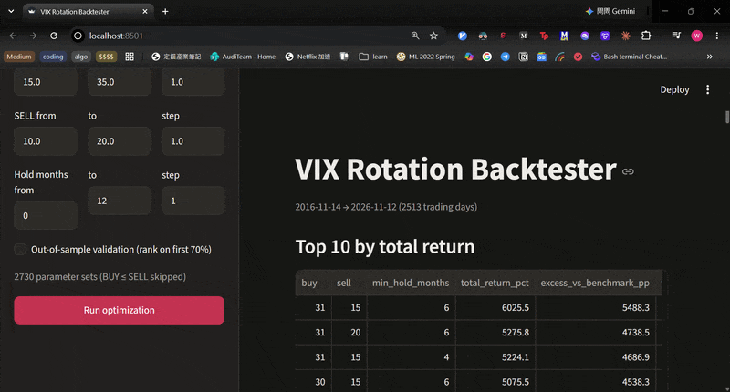

# VIX Rotation Backtester



**Stop guessing VIX thresholds. Let the data find them.**

VIX Rotation Backtester sweeps thousands of BUY / SELL / holding-period combinations for a VIX-driven switch between a growth asset (e.g. QQQ or 0050) and a defensive asset. It ranks every combination by return, then checks the winners out-of-sample so you can see which ones hold up.

- **Grid search** over BUY and SELL thresholds and minimum holding months, with results in a web UI
- **Heatmap** of excess return over a buy-and-hold benchmark, so you can see the whole parameter landscape at once
- **US and Taiwan markets** in one tool, mixable (e.g. `0050/0052` as the signal, `QQQ` as the asset)
- **Out-of-sample validation** to flag strategies that only looked good on past data

Nothing is written to disk; all results appear on the page. Term definitions are in [GLOSSARY.md](GLOSSARY.md) (in Chinese).

中文版說明請見 [README.zh-TW.md](README.zh-TW.md)。

## Run

```bash
pip install -U numpy pandas plotly streamlit yfinance requests
streamlit run app.py
```

## Markets

Both US and Taiwan (TWSE-listed and TPEx/OTC) securities are supported, and can be mixed:

- A ticker that starts with a **digit** is Taiwanese: type just the code, without `.TW` / `.TWO` (e.g. `0050`, `0052`, `00631L`, `2330`, `6488`). Its prices come from the free [FinMind](https://finmindtrade.com/) API.
- Any other ticker (e.g. `QQQ`, `^VIX`) is US / Yahoo Finance.
- The rule applies to the Signal too, e.g. `0050/0052`.
- The default Signal is still US ^VIX. Its day-*t* close (early morning Taipei time on *t+1*) is known before the Taiwan *t+1* open, so there is no look-ahead.
- When the two assets come from different markets, only days both traded are used, and returns are **not** currency-converted (the sidebar shows a reminder).
- FinMind's free tier is rate-limited; set the `FINMIND_TOKEN` environment variable to use your own token if needed.

## Trading rules

1. Performance is always expressed as **return rate**.
2. Day 1 is an **observation day**; no assets are held. On day 2 at the open, a position is opened based on day 1's close Signal: if Signal is **strictly greater** than BUY, buy the Growth Asset; otherwise buy the Defensive Asset.
3. While holding the Defensive Asset, if the previous trading day's Signal close is **strictly greater** than BUY, switch to the Growth Asset at the next trading day's open.
4. While holding the Growth Asset, if the signal day's Signal is **strictly less** than SELL, and the signal day is at least the minimum holding period (calendar months) after the most recent Growth purchase, switch to the Defensive Asset at the next trading day's open. A low Signal that occurs before the holding period is over is ignored; it is not deferred until the period ends.
5. Every new purchase of the Growth Asset restarts the holding-month count.
6. Commission is charged on each side: once when the first position is opened, and twice for each asset swap.
7. The Benchmark buys the Defensive Asset at the open on the second day after the observation day and holds it to the end, starting on the same day as the Rotation.
8. US prices use yfinance's `auto_adjust=True` adjusted prices. Taiwan prices are FinMind raw prices back-adjusted by this app for every ex-dividend and split event (scaling earlier prices by after ÷ before reference price). Both only approximate total return with dividends reinvested. Days a source reports a zero price are treated as missing.

## Page

- **Signal dropdown**: `VIX level` (^VIX; default BUY 15–35, SELL 10–20), `VIX term structure` (^VIX ÷ ^VIX3M; default BUY 0.95–1.15, SELL 0.80–0.95, step 0.01; values above 1 indicate backwardation, i.e. short-term fear; ^VIX3M data starts in 2007-12), and `Custom` (any ticker, or a `A/B` ratio). Switching the Signal automatically resets the BUY/SELL ranges to that Signal's defaults. Ratios use only dates where both tickers have a close.
- **Sidebar**: enter the three tickers, period, commission, and the ranges and steps for BUY, SELL, and holding months. Combinations where BUY ≤ SELL are skipped automatically. An optional out-of-sample validation is available: parameters are searched on the first 70% of the period, and returns are then computed separately on the last 30%.
- **Results**: top 10 by total return; a BUY × SELL heatmap showing excess return over the Benchmark, centered at 0 (green = win, red = loss); and two linked charts for the selected parameters. The upper chart shows the return curve with buy/sell markers and Growth holding periods; the lower chart shows the Signal (VIX) over time with the BUY and SELL threshold lines. Metrics and the trade log are also included.
- Percentage values such as return rates are displayed to one decimal place; internal calculations and ranking use full precision.

## Architecture

```
utilities/
  domain.py        Position, Universe, ParameterSet, Trade
  market_data.py   MarketData (numpy arrays); yfinance (US) and FinMind (Taiwan) downloads
  strategies.py    Strategy interface, VixRotation, BuyAndHold
  engine.py        Day-by-day simulation, outputs a return index
  metrics.py       Total return, CAGR, max drawdown, volatility
  optimizer.py     Grid search and in-sample / out-of-sample split
  charts.py        Plotly charts
app.py             Streamlit UI
```

To add a new strategy: subclass `Strategy` and implement `decide()`.

The "best" parameters found on a single historical dataset are at risk of overfitting; interpret them together with the out-of-sample validation.
