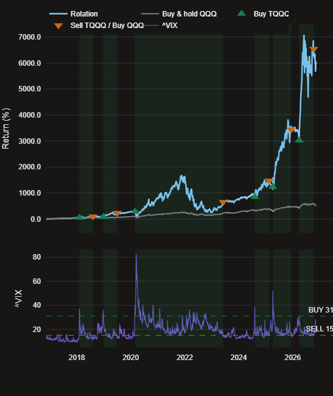
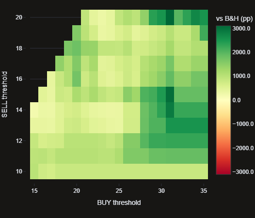

# VIX Rotation Backtester

<table>
  <tr>
    <td width="50%"></td>
    <td width="50%"></td>
  </tr>
</table>

English version: [README.md](README.md)

**別再猜 VIX 門檻，讓數據告訴你。**

VIX Rotation Backtester 會窮舉數千組 BUY / SELL / 最短持有月數的組合，在成長型資產（例如 QQQ 或 0050）與防禦型資產之間，依 VIX 訊號進行輪動。它依報酬率排序所有組合，再用樣本外驗證檢查前幾名，讓你看出哪些結果經得起考驗。

- **網格搜尋** BUY、SELL 門檻與最短持有月數，結果在網頁上呈現
- **熱力圖** 顯示相對買進持有 Benchmark 的超額報酬，整體參數分布一目了然
- **美股與台股** 同一個工具支援，可自由混搭（例如以 `0050/0052` 作為 Signal、`QQQ` 作為標的）
- **樣本外驗證** 標出只在過去資料上表現好的策略

不會輸出任何檔案，所有結果只顯示在頁面上。用語定義見 [GLOSSARY.md](GLOSSARY.md)。

## 執行

```bash
pip install -U numpy pandas plotly streamlit yfinance requests
streamlit run app.py
```

## 市場

支援美股和台股（上市、上櫃），兩者也可以混搭：

- 代號以**數字**開頭就是台股，只要輸入代號、不用加 `.TW` / `.TWO`（例如 `0050`、`0052`、`00631L`、`2330`、`6488`）。價格來自免費的 [FinMind](https://finmindtrade.com/) API。
- 其他代號（例如 `QQQ`、`^VIX`）是美股，來自 Yahoo Finance。
- Signal 欄位也適用同樣規則，例如 `0050/0052`。
- 預設 Signal 仍是美國 ^VIX。美股 *t* 日收盤在台北時間 *t+1* 清晨，早於台股 *t+1* 開盤，因此沒有前視偏差。
- 兩檔資產分屬不同市場時，只取兩邊都有交易的日子，報酬**未做匯率換算**（側欄會顯示提示）。
- FinMind 免費版有呼叫次數上限；需要時可設定環境變數 `FINMIND_TOKEN` 使用自己的 token。

## 交易規則

1. 績效一律以**報酬率**表示。
2. 第一天是**觀察日**，不持有任何資產。第二天開盤依第一天收盤的 Signal 建立部位：嚴格大於 BUY 就買 Growth Asset，否則買 Defensive Asset。
3. 持有 Defensive Asset 時，前一交易日的 Signal 收盤**嚴格大於** BUY：在下一個交易日開盤換成 Growth Asset。
4. 持有 Growth Asset、訊號日的 Signal **嚴格小於** SELL，而且訊號日距最近一次買進已滿最短持有月數（曆月）：在下一個交易日開盤換成 Defensive Asset。提早出現的低 Signal 直接忽略，不會延後到持滿時才執行。
5. 每次重新買進 Growth Asset，持有月數都重新計算。
6. 手續費每一邊各扣一次：建立第一筆部位扣一次，資產互換扣兩次。
7. Benchmark 在觀察日後的第二天開盤買進 Defensive Asset 並持有到結束，和 Rotation 同一天起跑。
8. 美股價格使用 yfinance 的 `auto_adjust=True` 調整價；台股價格是 FinMind 原始價，由本程式依每次除權息與分割事件往前還原（以前價格乘上 除權息後 ÷ 前 參考價）。兩者都只是含配息再投入的近似值。資料來源回報為 0 的價格視為缺值。

## 頁面

- **Signal 下拉選單**：`VIX level`（^VIX，BUY 15–35、SELL 10–20）、`VIX term structure`（^VIX ÷ ^VIX3M，BUY 0.95–1.15、SELL 0.80–0.95，步長 0.01；大於 1 代表逆價差、短期恐慌；^VIX3M 從 2007-12 起才有資料）、`Custom`（任意代號或 `A/B` 比值）。切換時 BUY/SELL 範圍會自動換成該 Signal 的預設值。比值只取兩檔都有收盤的日期。
- **側欄**：輸入三檔標的、期間、手續費，以及 BUY、SELL、持有月數的範圍和步長；BUY ≤ SELL 的組合會自動略過。可另外開啟樣本外驗證：用前 70% 期間找參數，後 30% 期間另外計算報酬。
- **結果**：依總報酬率列出前 10 名、BUY × SELL 熱力圖（顯示相對 Benchmark 的超額報酬，以 0 為中心：綠色贏、紅色輸），以及所選參數的上下兩張連動圖：上方是報酬曲線（含買賣標記和 Growth 持有區間），下方是 Signal（VIX）走勢和 BUY、SELL 門檻線；另附各項指標和交易紀錄。
- 報酬率等百分比數值顯示到小數點第一位，內部計算和排名仍用完整精度。

## 架構

```
utilities/
  domain.py        Position、Universe、ParameterSet、Trade
  market_data.py   MarketData（numpy 陣列）、yfinance（美股）與 FinMind（台股）下載
  strategies.py    Strategy 介面、VixRotation、BuyAndHold
  engine.py        逐日模擬，輸出報酬指數
  metrics.py       總報酬、CAGR、最大回撤、波動度
  optimizer.py     網格搜尋與樣本內／外切分
  charts.py        Plotly 圖表
app.py             Streamlit 介面
```

新增策略的方法：繼承 `Strategy`，實作 `decide()`。

在同一段歷史資料中找出的「最佳」參數有過度擬合的風險，請搭配樣本外驗證判讀。
